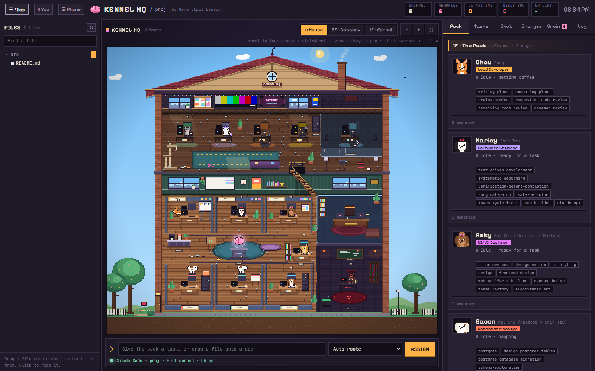
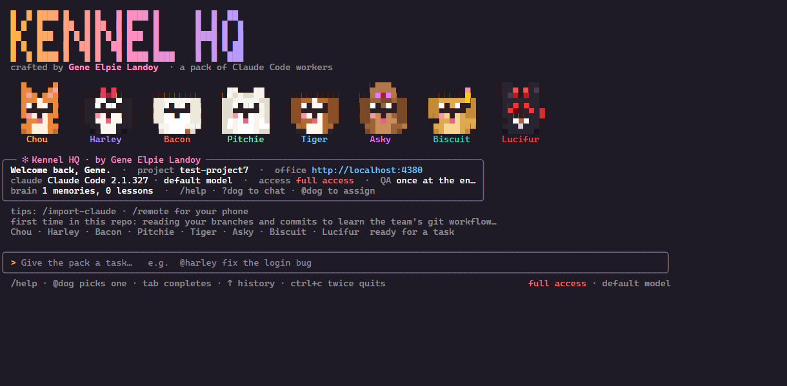

| Lucifur | caveman-explore, investigate-first · systematic-debugging, brainstorming, receiving-code-review | caveman · superpowers || Biscuit | humanizer · doc-coauthoring, internal-comms · writing-skills | [blader/humanizer](https://github.com/blader/humanizer) · anthropics/skills · superpowers || Tiger | terrashark · finishing-a-development-branch, using-git-worktrees, verification-before-completion · caveman-commit, lean-build, verify-and-stop | [LukasNiessen/terrashark](https://github.com/LukasNiessen/terrashark) · superpowers · caveman || Pitchie | webapp-testing · test-driven-development, verification-before-completion, systematic-debugging · caveman-review, verify-and-stop | anthropics/skills · superpowers · caveman || Bacon | postgres, design-postgres-tables, postgres-database-migration, schema-exploration, migrate-postgres-tables-to-hypertables · migration · verification-before-completion | [timescale/pg-aiguide](https://github.com/timescale/pg-aiguide) · caveman · superpowers || Asky | ui-ux-pro-max, design-system, ui-styling, design · frontend-design, web-artifacts-builder, canvas-design, theme-factory | [nextlevelbuilder/ui-ux-pro-max-skill](https://github.com/nextlevelbuilder/ui-ux-pro-max-skill) · [anthropics/skills](https://github.com/anthropics/skills) |# Kennel HQ

**An AI dev team of pixel-art dogs, powered by Claude Code.**
*by Gene Elpie Landoy*

A pixel-art office where a pack of dogs writes your code. Each dog is a headless Claude Code worker running on **your own Claude login** (no API key). You give them work from the terminal, from the office in your browser, or from Claude Code itself. Big requests get planned into tickets, finished work goes through QA, mistakes become lessons, and everything is saved in a shared brain inside your project.



| Dog | Breed | Role | Gets work like |
|---|---|---|---|
| **Chou** | Corgi | Lead Developer | planning, reviews, decisions, splitting big requests into tickets |
| **Harley** | Shih Tzu | Software Engineer | app code, frontend and backend |
| **Asky** | Mal-Shi (Shih Tzu × Maltese) | UI/UX Designer | UX flows, visual design, design systems, accessibility, motion, CSS/Tailwind, built in code |
| **Bacon** | Mal-Shi (Maltese × Shih Tzu) | Database Manager | schemas, SQL, migrations, indexes |
| **Pitchie** | Japanese Spitz | QA Tester | tests, bug hunts, and the QA gate |
| **Tiger** | Beagle | DevOps Engineer | CI/CD, Docker, infra, deploy runbooks |
| **Biscuit** | Golden Retriever | Technical Writer | READMEs, guides, API docs, code comments, changelogs; keeps docs in sync with the code |
| **Lucifur** | Doberman | Mentor | explains code and concepts step by step; looks like a villain, talks like a senior engineer. Never changes code. |

## Requirements

- A Claude account (Pro, Max, Team or Enterprise)
- [Node.js](https://nodejs.org) 22+ and [Claude Code](https://claude.com/claude-code). The one-line installer below sets both up for you if they're missing.

## Install

```bash
npm i -g kennel-hq
```

Then go to any project and type `kennel`. That's it. (Needs [Node.js](https://nodejs.org) 22+ and [Claude Code](https://claude.com/claude-code); run `claude` once to log in.)

**Brand-new laptop with nothing installed?** This one line sets up Node.js and Claude Code for you too (no admin or sudo):

```powershell
# Windows (PowerShell)
irm https://raw.githubusercontent.com/PrimeSalad/kennel-hq/main/install.ps1 | iex
```
```bash
# macOS / Linux / WSL
curl -fsSL https://raw.githubusercontent.com/PrimeSalad/kennel-hq/main/install.sh | bash
```

To update, run the same command again.

Then, optionally: `kennel install-skill` adds the `/kennel` skill to Claude Code.

<details><summary>From source (for contributing)</summary>

```bash
git clone https://github.com/PrimeSalad/kennel-hq.git
cd kennel-hq
npm install
npm link                 # adds the `kennel` command everywhere
```
</details>

The first time `kennel` runs it downloads each dog's skills from GitHub (about 20 seconds).

## Use it

Go to any project and start it:

```bash
cd C:\path\to\your-project
kennel
```



The terminal works like Claude Code: the pack in pixel art, a live line for each working dog (what it's reading, editing or running), every tool call as it happens, and an input box at the bottom.

```
> fix the login validation bug
> @bacon add an index for orders by user_id
> ?lucifur bakit nag-e-error yung login?
> add a discount() to cart.js, then tests for it, also a README section
```

- **Everything goes through Lucifur's front desk first, and the desk is the one central dispatcher.** Every message lands in one inbox. Messages you send at the same time (or while the desk is still deciding) are read **together in one small call** that also sees the live board: who's working on what, what's queued, and what just finished. For each message it decides:
  - **reply**: greetings, thanks, "what's the team doing?" are answered right at the desk, with **no job started**
  - **question**: goes to a dog's chat (much cheaper than a job). Questions sent while that dog is still answering are queued and sent together.
  - **follow**: builds on a job on the board ("also…", "pati…", "yung kanina", "make it blue instead"). The **same dog continues in its own session**, without re-reading the project. If that job is still running, the follow-up waits and then continues it.
  - **fix**: says a finished job is wrong. It goes back to that dog's session, and the dog learns a lesson.
  - **add**: extra detail for a job that hasn't started yet. It's folded into that job, so nothing extra runs.
  - **same**: already running or queued. Nothing new starts. Exact repeats are caught before any model is called.
  - **task / plan**: new work, with a short brief naming the files to look at. Related messages in the same batch are merged into one job; unrelated ones stay separate so different dogs work in parallel.
- **No two dogs in the same file.** The desk lists the files each job will likely touch. A job whose files another dog is editing right now waits for it (`Pitchie waits for Harley to finish with src/login.js`). Every dog also gets a short "teammates right now" note, so it works around the others.
- The desk uses Haiku when the pack is quiet and Sonnet when there's a board to reason about (`--triage-model` to change). It's still one call with no tools. Start a message with `!` to skip the desk, or run `kennel --no-triage`.
- **Small tasks** go straight to the right dog. Kennel routes by keyword: database words go to Bacon, tests to Pitchie, deploy/CI to Tiger, UI/design to Asky, docs to Biscuit, "explain / bakit / paano" to Lucifur, plans and reviews to Chou, everything else to Harley.
- **Big or multi-part requests** go to Chou first. Chou splits them into tickets, and a ticket waits for the ones it depends on.
- `@dog <task>` sends a task straight to one dog, with no planning.
- `?dog <message>` **chats** with a dog. They can read your code to answer, but nothing gets changed. Replies are professional and come back in the language you wrote in (English, Tagalog, Taglish, or any other).

### Terminal commands

| Command | What it does |
|---|---|
| `?dog <message>` · `/chat <dog> <message>` | talk to a dog (try `?lucifur`) |
| `/status` | who's doing what, queues, QA backlog, how much of your 5h limit is used |
| `/follow <id> <what>` | ask for more on a finished job; the dog continues in the same session (cheaper) |
| `/undo <id>` | put back exactly the files that job changed (a git checkpoint is taken before every job) |
| `/commit <id>` | commit that job's files with a message in your team's style (no co-author lines) |
| `/usage` · `/budget 500k` | tokens per dog and per day · a daily budget that pauses new work when it's used up |
| `/plan <request>` | force Chou to plan it into tickets |
| `/qa` | run QA now instead of waiting for the pack to go quiet |
| `/bad <id> <what's wrong>` | send work back; the dog learns from it and fixes it in the same session |
| `/teach <dog\|team> <rule>` | teach a lesson, e.g. `/teach team we use pnpm, not npm` |
| `/lessons [dog]` | what they've learned |
| `/import-claude` | copy what Claude Code remembers about how you work into the team's lessons |
| `/learn-git` | learn your branch naming, commit style and merge flow from the repo's history (also runs automatically the first time) |
| `/remote` · `/remote off` | open the office on your phone over Wi-Fi, with a QR code |
| `/brain [search]` · `/read <id>` | browse the brain (ids are shown in `/brain`) |
| `/watch <dog>` | stream a dog's writing live in the terminal |
| `/stop <dog>` | stop what a dog is doing |
| `/resume` | continue after a limit pause |
| `/open` · `/quit` | open the office · close Kennel (or press Ctrl+C twice) |

**Keys:** Tab completes commands and dog names, ↑/↓ browse history, Ctrl+←/→ jump words, Ctrl+U clears the line, and pasting works normally.

### The office (browser)

- **Files** (left): your project's files. Click one to read it. **Drag a file onto a dog** (in the room or on their card) to hand it over, then type what they should do with it. Files the dogs change get an **M** in the dog's color.
- **You:** click **☺ You** (or your office) to set your name and look: male or female, skin, hair and outfit. You sit at the boss desk in every project, and your hands type when you type.
- **The room:** every dog has a cubicle. **Your boss office** is top-right (a little envelope flies from your desk to the dog whenever you assign something), and **Lucifur's lair** is below it. Click a dog to follow it; double-click to chat.
- **Tasks:** every prompt you give, live and step by step. You see what the dog is writing right now, each edit as a red/green diff the moment it happens, and the answer or report when it's done (ask a question as a task and the answer shows up right there): who took it, what they read, edit and run, the diff, and the QA result. The line under the input box shows what your latest task is doing right now.
- **On every finished task:** **↶ Undo** (puts the files back the way they were before that job), **Commit** (writes the message for you), **Run QA on this**, and a **follow-up** box to ask for more in the same session. Running tasks have **Stop**, queued ones **Cancel**. The Tasks list survives restarts.
- **Usage:** click the 5h-limit box in the header for tokens today, per dog and per day, your Claude limits, and a daily budget.
- **Notifications:** when a task finishes or needs you while the office is in the background, you get a desktop notification.
- **Breaks:** a dog with nothing to do wanders off to the coffee machine, water bowl, nap corner, ball or ticket board, and runs straight back to its desk when work comes in. The terminal and `kennel status` show the same thing ("Tiger napping").
- **Pick up a dog:** drag any dog around the room; it sits where you drop it for a moment, then walks back to its desk.
- **Pack:** each dog's live action ("Editing src/cart.ts", "$ npm test"), progress, recent work, lessons, and a box to teach them.
- **Chat:** talk with any dog. Drop files in to show them. **Make it a task** sends the message as real work instead.
- **Changes:** every edit as it happens, as a red/green diff, filterable by dog.
- **Brain:** everything the pack finished, with search and filters. Click a memory to read the full report or **Send back** with what's wrong.
- **Log:** a live feed of edits, commands, QA verdicts and lessons.


## Skills

Each dog gets its own set of skills from popular open-source skill repos on GitHub. Kennel downloads them the first time it runs (about 20 seconds) into `~/.kennel`, and gives each dog only its own skills as a Claude Code plugin. A skill's full text only loads when a dog actually uses it, so having them costs about 1.4k tokens per job.

| Dog | Skills | From |
|---|---|---|
| Chou | writing-plans, brainstorming, requesting-code-review, receiving-code-review | [obra/superpowers](https://github.com/obra/superpowers) |
| Harley | test-driven-development, systematic-debugging, verification-before-completion · surgical-patch, safe-refactor, investigate-first | superpowers · [JuliusBrussee/caveman](https://github.com/JuliusBrussee/caveman) |
| Asky | ui-ux-pro-max, design-system, ui-styling · frontend-design, theme-factory | [nextlevelbuilder/ui-ux-pro-max-skill](https://github.com/nextlevelbuilder/ui-ux-pro-max-skill) · [anthropics/skills](https://github.com/anthropics/skills) |
| Bacon | postgres, design-postgres-tables, postgres-database-migration, schema-exploration · migration | [timescale/pg-aiguide](https://github.com/timescale/pg-aiguide) · caveman |
| Pitchie | webapp-testing · test-driven-development, verification-before-completion · verify-and-stop | anthropics/skills · superpowers · caveman |
| Tiger | terrashark · finishing-a-development-branch · lean-build, verify-and-stop | [LukasNiessen/terrashark](https://github.com/LukasNiessen/terrashark) · superpowers · caveman |
| Biscuit | humanizer | [blader/humanizer](https://github.com/blader/humanizer) |
| Lucifur | systematic-debugging · investigate-first | superpowers · caveman |

All of them are MIT or Apache-2.0 and are used unchanged. Each skill folder keeps its upstream license, and `~/.kennel/dogs/<dog>/CREDITS.md` lists the sources. `/skills` shows them; `/skills update` downloads the latest versions.

## Use it from Claude Code (the skill)

After `kennel install-skill`, just talk to Claude Code:

> "ipasa mo kay Harley yung login bug"
> "send this to the pack: add CSV export to the reports page"
> "what did the dogs do?"

Claude starts Kennel in the background if it isn't running (`kennel serve`), sends the task with a clear, self-contained brief, waits for the report, checks the diff, and tells you what changed. You can also type `/kennel`.

The same commands work in any terminal in the project folder while Kennel is running:

```bash
kennel serve                         # start in the background (no prompt)
kennel ask "<task>" [--dog bacon] [--plan] [--wait]
kennel status | wait | brain [search] | read <id> | lessons [dog]
kennel teach <dog|team> "<rule>"
kennel bad <id> "<what's wrong>" [--wait]
kennel qa [--wait] | import-claude | stop
```

`--wait` blocks until the pack is quiet (QA included) and prints a report of the work, QA verdicts, lessons and anything that needs you.

## How the workflow saves tokens

| Rule | Why |
|---|---|
| Jobs run lean: only the tools a coder needs (no web, no subagents), no skills list (except Asky), and the git status moved out of the system prompt so it stays cached between jobs; relevant lessons only | About half the tokens per job (measured: 81k → 39k on the same fix) |
| **Opus does the work**; the cheap models do everything around it: Haiku for the front desk and chat, Sonnet for the occasional QA. The front desk sizes each job, and small jobs run Opus at low effort. `--model` picks another work model | The expensive model only runs on real work |
| Small and medium jobs (and planning, QA, chat) run on a short system prompt of ours instead of Claude Code's full one; only large jobs get the full prompt | Less context re-sent on every turn |
| Chat defaults to Haiku (`--chat-model` to change) | Questions are cheap |
| Effort is set per kind of work: low for planning and QA, medium for jobs (override with `--effort`) | Less thinking spent where it doesn't help |
| **Lucifur's front desk** reads every message first on one small call, and messages sent together share that call | "hi", "salamat" and quick questions never start a 50–90k-token job |
| **Follow-ups go back to the same session** automatically, even without `/follow` | "pati yung error message" continues the job instead of a fresh 40k-token re-read |
| Duplicates and related messages are merged; additions to a queued job are folded in | Sending three prompts at once doesn't mean three jobs |
| Chou plans big requests into tickets with an order | No two dogs fight over the same file, and no work gets redone |
| **Smart QA (default):** a change only gets a QA check when it's risky: migrations, auth, payments, CI/config, more than 150 lines or 5 files, or a big change the dog didn't test. Everything else skips it. `--review always` checks everything, `--review off` nothing, and **Run QA on this** in the Tasks tab checks one job on demand | No tokens spent re-checking small, tested changes |
| When QA does run, it runs once at the end and checks all pending work in one pass | One test run instead of one per change |
| QA and chat use **Sonnet** (`--qa-model`, `--chat-model`) | Lighter on your limit; the work itself uses your default model |
| Chat runs lean: its own short system prompt, no MCP connectors, low effort | About 5k tokens per message instead of ~22k (measured) |
| Your claude.ai connectors (Gmail, Drive, …) aren't loaded for the dogs | Fewer tokens on every job; pass `--mcp` if a project needs them |
| Fixes and follow-up chats **resume the same Claude session** | No re-reading the whole project |
| Brain context is trimmed to the most relevant notes | Smaller prompts |
| At **80%** of your 5h limit QA is skipped; at **95%** new work waits and resumes after the reset | You don't run out mid-day |

## How they learn and avoid mistakes

No AI is mistake-free. Kennel stacks four checks:

1. **Self-check.** Every dog must run the project's own checks (tests, typecheck, lint, build) after changing code, and may not claim something works without verifying it.
2. **QA gate.** Pitchie checks everyone's work (Chou checks Pitchie's). A failed job goes back to its author with the findings, up to **2 fix rounds**. If it still fails, it's marked **! needs you**.
3. **Lessons.** Every QA failure, every `/bad`, every `/teach`, and each dog's own takeaway becomes a lesson that dog (or the whole team) reads before every future task.
4. **Your git workflow.** Kennel reads your branches, merges and commit messages and turns them into team rules (branch names like `feat/SHOP-21-…`, conventional commits, PR template). Dogs only create branches, commit or push when you ask, and then they follow those rules.
5. **Your Claude Code memory.** `/import-claude` brings in how you like to work. Notes from other projects are first boiled down into general rules, so client names and project details don't leak between projects.

## Control it from the Claude app

Type `/claude-remote` in the terminal, or click **▣ Phone → Start Claude Remote Control** in the office. A new window opens with a Claude Code session that has Remote Control on and knows it drives the pack. On your phone, open the Claude app → **Code**, pick the session named **Kennel · <folder>**, and just say what you want ("ipagawa mo kay Harley yung login bug"). It sends the work to the dogs with `kennel ask` and reports back. Keep that window open while you use it.

## Remote (your phone)

Click **▣ Phone** in the office header and press **Turn on**: a QR code appears right on the page. You can also start with `kennel --remote` or type `/remote` in the terminal. Kennel opens a second port on your Wi-Fi and prints a QR code. Scan it with your phone and you get the whole office: watch the dogs, assign tasks, chat. The link carries a private key, and anyone without it gets a 401. Windows may ask to allow Node.js on private networks the first time. To reach it from outside your network, put it behind something like Tailscale.

## Access and safety

By default the dogs run with `--dangerously-skip-permissions`: they can read, edit, and run **any command** in your project. They're told never to run destructive commands, touch production, or force-push. That's an instruction in their prompt, not a hard block, so **use git** and commit before big jobs so you can undo anything. Lucifur and chats are always read-only.

| Flag | Access |
|---|---|
| *(default)* | full access, including shell commands |
| `--safe` | read and edit files, no commands |
| `--read-only` | read only |

Other flags: `--remote`, `--mcp`, `--model <name>`, `--qa-model <name>`, `--chat-model <name>`, `--effort <level>`, `--no-review`, `--no-plan`, `--port <n>`, `--no-open`. Run `kennel --help` for the full list.

## Where things are saved

Your avatar is saved once for all projects in `~/.kennel/profile.json`.


Everything for a project lives in `<project>/.kennel/`, which is git-ignored automatically:

```
.kennel/
  brain.json        every job: who, what, status, files, session id
  memories/<id>.md  each job's full report
  lessons.json      what the dogs have learned
  chats.json        your conversations with each dog
  events.json       the Tasks timeline
  git.json          when the git workflow was last learned
  usage.json        token totals
  server.json       port + pid while Kennel is running
```

## Troubleshooting

- **"Claude Code CLI not found":** install Claude Code and run `claude` once to log in. If it's somewhere unusual, set `KENNEL_CLAUDE` to its full path.
- **Keys act weird in Git Bash:** use PowerShell or Windows Terminal. Git Bash (mintty) doesn't give Node a real terminal; `winpty kennel` works around it.
- **"Kennel HQ is already running for this folder":** use `kennel status` / `kennel ask`, or `kennel stop`. If it's wrong, delete `.kennel/server.json`.
- **Port in use:** Kennel tries the next free port automatically, or pass `--port`.

## Project layout

```
bin/kennel.mjs          the `kennel` command
src/server.mjs          orchestrator, workers, chat, HTTP + live events, terminal wiring
src/client.mjs          `kennel ask|status|wait|…` commands that talk to a running Kennel
src/tui.mjs             the Claude-Code-style terminal UI
src/sprites.mjs         the dogs as terminal pixel art
src/remote.mjs          remote mode: LAN address, access token, QR code
public/index.html       the office (canvas pixel art, no build step)
skills/kennel/SKILL.md  the Claude Code skill
docs/                   screenshots
```

## License

MIT © Gene Elpie Landoy. The dogs' skills are third-party projects under their own licenses (see [Skills](#skills)).
